# The Boxx — coached-training studio website

**Case study · Website rebuild** · April 2026 · Freelance · [theboxx.in](https://theboxx.in)

A coached-training studio's website, rebuilt and relaunched in about 19 hours — AI-assisted.

**Status:** live at [theboxx.in](https://theboxx.in) since the April 2026 relaunch.

**My role:** designed and delivered the rebuild, AI-assisted: I gathered the requirements, made the product and design decisions, directed AI coding tools, tested every change and ran the relaunch, replacing the studio's earlier site. I also chose the studio's membership software, FitGymSoftware, and set it up with the vendor, with 27 membership plans.

> **Case study PDF.** This page tells the same story as my 14-page PDF case study, *The Boxx — case study*, chapter for chapter (01–12 below), with more screens. The PDF itself is not in this repo; ask for it through the contact details on my [GitHub profile](https://github.com/abBytes-sudo).

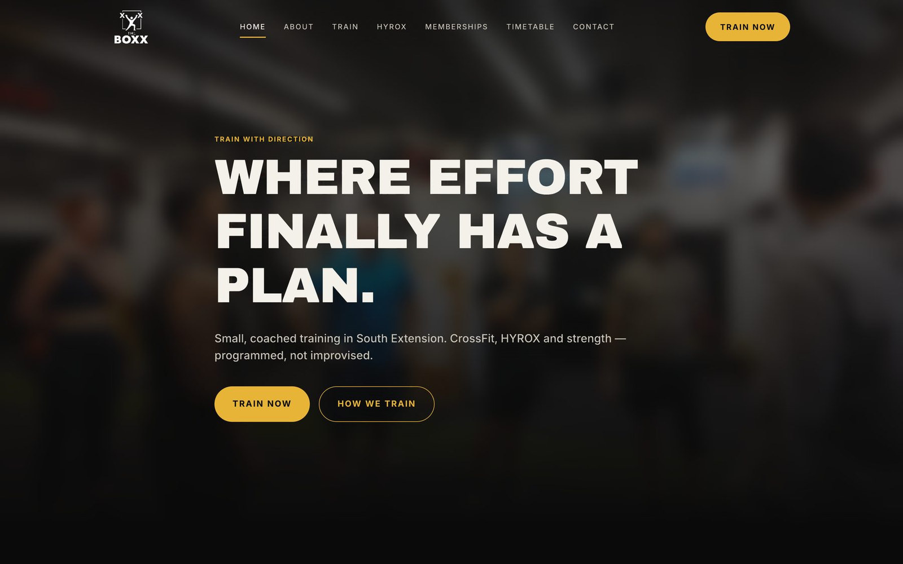

*Home, desktop (live): the hero at theboxx.in; member photos blurred for privacy.*

  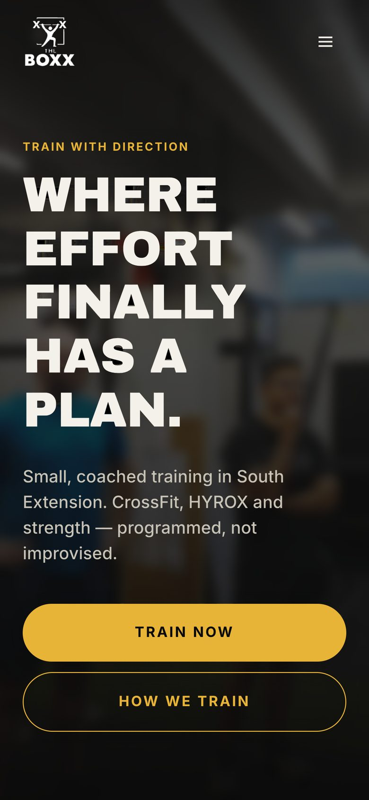 
  <em>Home, phone (live): the same hero on a phone; member photos blurred for privacy.</em>

### What makes it different
- **Every hour has a shape.** Collective, HYROX and the kids' bootcamp each break a session into four steps, so visitors see what their hour will look like before anyone books.
- **One next step everywhere.** "Train now" in every page header and the phone menu opens the enquiry form for a free first session.
- **The site sells the first session; the app runs the rest.** Plans, bookings and renewals live in the members app (FitGymSoftware, 27 plans), so the website stays static, with no booking engine or payments to maintain.
- **Changes without a website edit.** Plans beyond the six change in the app; specialty blocks are announced in the app; the timetable shows class types, not coach names, so a rota change needs no edit; the Instagram feed (Behold) shows new posts; the enquiry form's questions are edited in Google Forms.
- **Mobile-first, no framework.** Static HTML pages, one stylesheet with design tokens, one vanilla JS file.

*About the screenshots:* screens marked **live** are from [theboxx.in](https://theboxx.in), with member and hero photos blurred for privacy. Screens marked **demo build** come from an earlier build with a placeholder brand ("Pulse"); they are cropped (and the background photos behind the Train, Memberships and Timetable headers blanked) to leave out coach and member photos and customer reviews, and their plan prices are masked as "Call for pricing", which is what the studio's site has shown since 16 Oct 2026. The About and Contact pages are not shown; theboxx.in has the full pages. The source is in a private repo; I can share it with a reviewer on request.

---

**Contents:** [01 The brief](#01--the-brief) · [02 What was built](#02--what-was-built) · [03 Home](#03--home) · [04 Formats](#04--formats) · [05 Coaching](#05--coaching) · [06 HYROX](#06--hyrox) · [07 Memberships](#07--memberships) · [08 Timetable](#08--timetable) · [09 Hand-off](#09--hand-off) · [10 Mobile](#10--mobile) · [11 Delivery](#11--delivery) · [12 How it was built](#12--how-it-was-built) · [More screens](#more-screens-full-pages-from-the-demo-build)

---

## 01 · The brief

### Make the studio feel as serious online as it is on the floor.
— and turn curiosity into a booked first session.

| Client | Engagement | When |
|---|---|---|
| a coached-training studio, South Extension, New Delhi | freelance | April 2026 |

1. **Explain the training.** CrossFit, HYROX and strength — each format explained, each with its own next step.
2. **Make joining easy.** "Train now" on every page opens the enquiry form for a free first session; plans live in the members app.
3. **Built for the phone.** Mobile-first: static pages, no framework, a little vanilla JavaScript.

---

## 02 · What was built

### Six pieces, one job: get people training.

**Site map:** Home · About · Train · HYROX · Kids & Teens · Memberships · Timetable · Contact

| Piece | What it does | Chapter |
|---|---|---|
| **Programme pages** | CrossFit-style group classes, HYROX, strength and one-to-one — each format explained, with its own call to action. | 04, 05 |
| **A dedicated HYROX page** | Running, stations, pacing and race prep — a page of its own for the race-training crowd. | 06 |
| **Memberships** | Six starting plans, plans at a glance on the home page, and a pointer to all 27 in the members app. | 07 |
| **Timetable** | The weekly class grid on its own page, filtered by class type in one tap. | 08 |
| **Members-app hand-off** | FitGymSoftware chosen and set up with the vendor, with 27 membership plans. | 09 |
| **Mobile-first, no framework** | Static HTML and CSS, no page builder. Dark, editorial, a little vanilla JS. | 10 |

**Page by page**
- **Home** — a bold hero, the four numbered "why here?" cards, a plans-at-a-glance counter, format cards (Collective / HYROX / Precision), the studio Instagram feed and the coaching team.
- **Train / HYROX / Kids & Teens** — the programme pages, each with its own framing, its "what the hour looks like" section and its call to action.
- **Memberships** — the free first session, the six starting plans, a pointer to all 27 plans in the members app, and an FAQ.
- **Timetable** — the weekly class grid, with class-type filters and a colour legend.
- **About** — the studio's story and philosophy.
- **Contact** — location, hours, an enquiry form, and WhatsApp / Instagram / call shortcuts.

---

## 03 · Home

### Four reasons, numbered.
Under the hero, the home page answers "why here?" in four short cards: direction, real coaching, one space for every discipline, and a small crew.

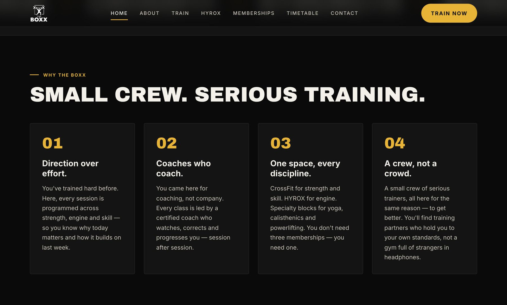

*Desktop · Home (live): four numbered cards in one row answer "why here?" before any price or schedule.*

  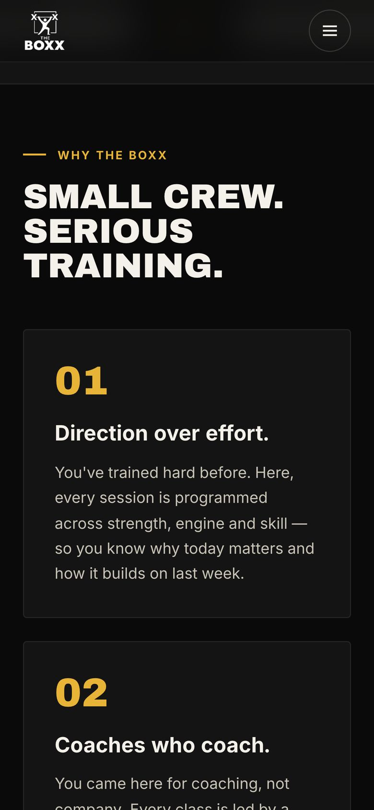 
  <em>Phone · Home (live): the same four cards, stacked into one readable column.</em>

---

## 04 · Formats

### Four formats, one studio.
Group classes, specialty blocks, one-to-one and open gym, with HYROX on its own page. Pick one; switch when life changes.

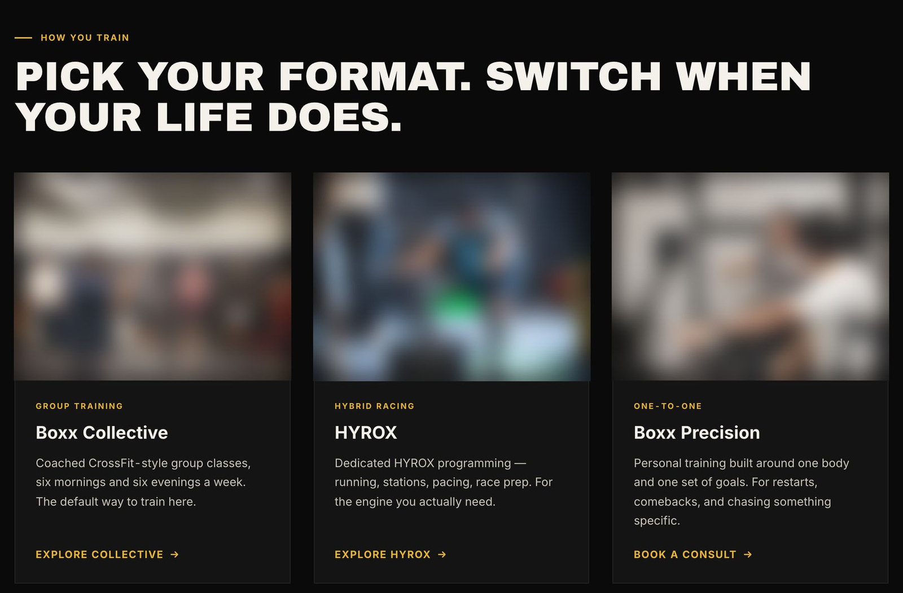

*Desktop · Home (live): group classes, HYROX and one-to-one Precision as cards, each with its own next step. Photos blurred for privacy.*

| Phone · Train (live) | Phone · Train (live) |
|:---:|:---:|
| 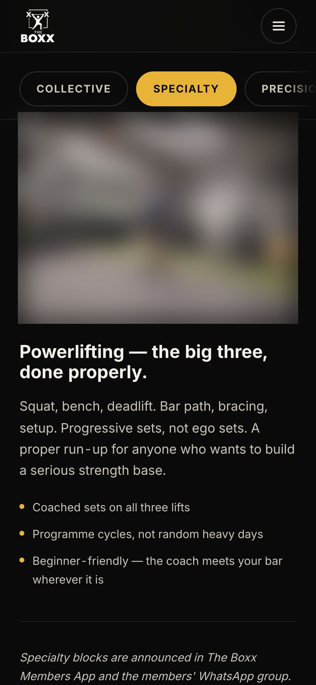 | 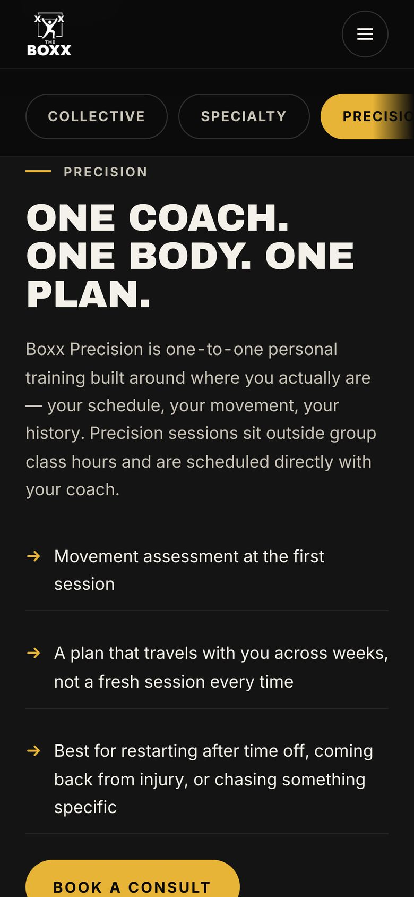 |
| Specialty blocks rotate; the members app announces which is on, so the site needs no edit. | Precision: one coach, one plan, booked as a consult. |

---

## 05 · Coaching

### Every hour has a shape.
Every programme page answers one question before anyone books: what will my hour look like? Collective, HYROX and the kids' bootcamp each break a session into four steps, so the coaching reads as one system, not a list of class names.

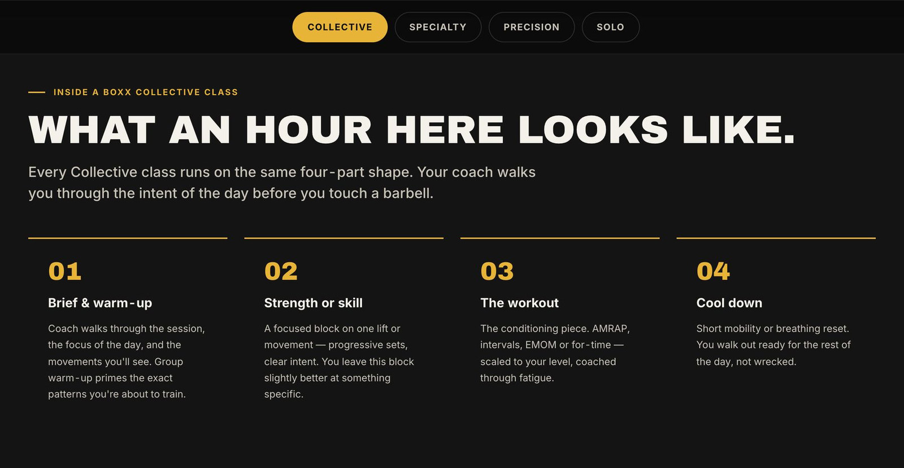

*Desktop · Train (live): a Collective class in four parts, and the coach explains the intent before you touch a barbell.*

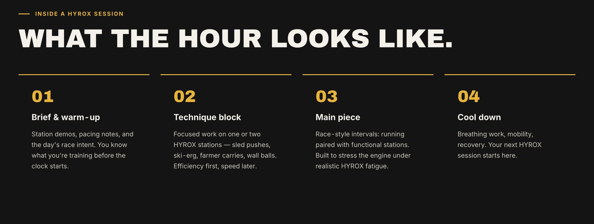

*Desktop · HYROX (live): the same four-part shape, tuned for race stations and pacing.*

  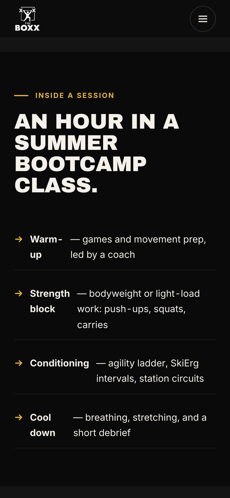 
  <em>Phone · Kids &amp; Teens (live): the summer bootcamp hour, written for parents: warm-up, strength, conditioning, cool-down.</em>

---

## 06 · HYROX

### HYROX gets its own page.
**On the page:** What HYROX is · What the hour looks like · Who it's for · Benchmarks & race prep · When it runs

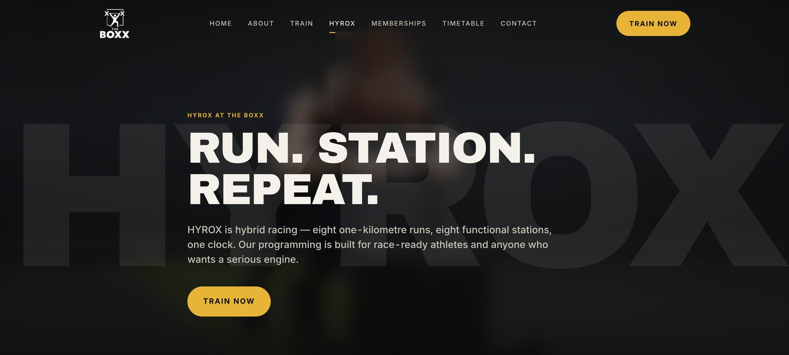

*Desktop · HYROX (live): race-training visitors land on a page written for them, which ends with when the HYROX Engine class runs on the timetable. Hero photo blurred for privacy.*

  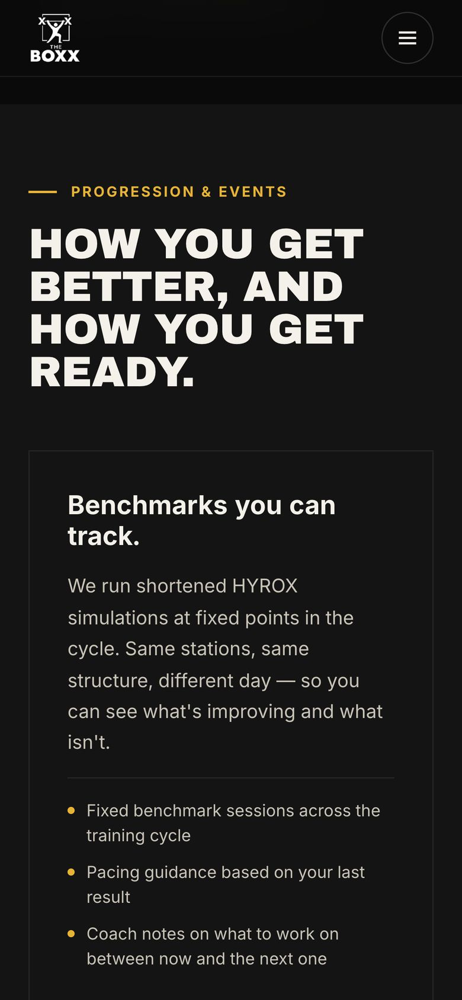 
  <em>Phone · HYROX (live): how members progress: fixed benchmark sessions, then coached race prep.</em>

---

## 07 · Memberships

### Six plans on the page. All 27 in the app.
The website shows six starting plans; each card says who it is for and ends in one action. All 27 are set up in FitGymSoftware (April 2026) with their sessions, validity and pricing, so plans beyond the six change in the app, with no website edit.

  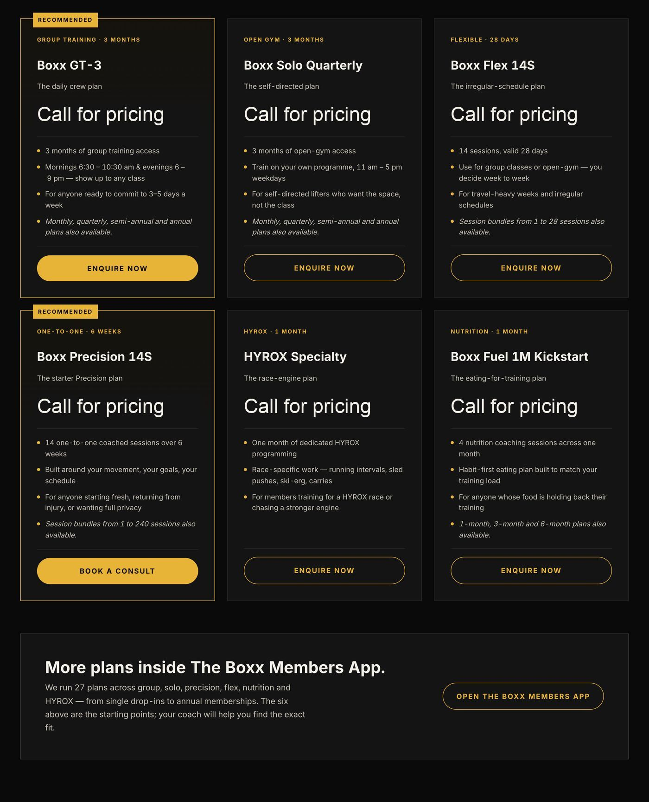 
  <em>Desktop · Memberships (live): six starting plans, one clear action each. Since 16 Oct 2026 the studio's site shows "Call for pricing".</em>

  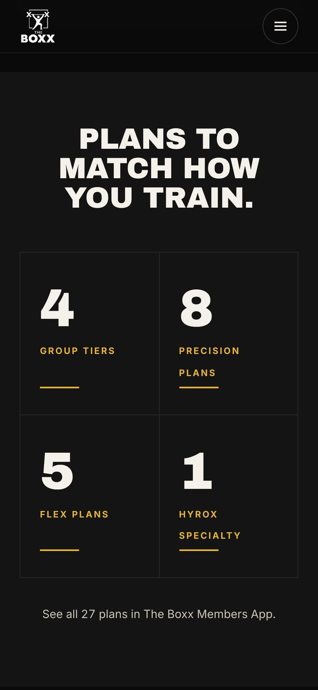 
  <em>Phone · Home (live): counts for four plan types at a glance, then a pointer to all 27 in the app.</em>

---

## 08 · Timetable

### One week, filtered in one tap.
Five class-type filters and a colour legend. Class types, not coach names: a rota change needs no website edit.

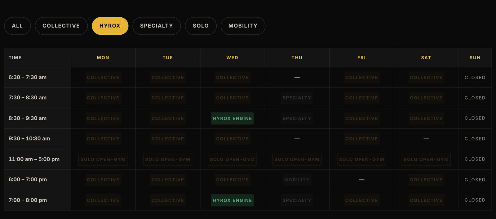

*Desktop · Timetable (live): the HYROX filter on: HYROX Engine slots light up, everything else dims, and the whole week stays in view.*

  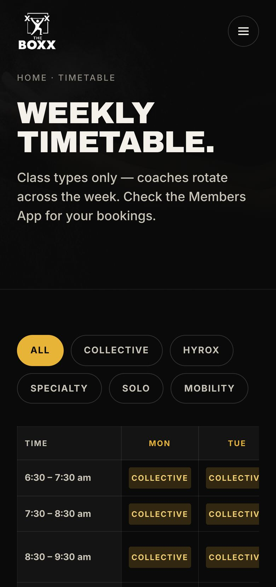 
  <em>Phone · Timetable (live): chips wrap to two thumb-size rows; the grid scrolls sideways, not smaller.</em>

---

## 09 · Hand-off

### The site sells the first session. The app runs the rest.

| 01 · "Train now" | 02 · Free first session | 03 · A coach helps pick the plan | 04 · The Boxx Members App |
|---|---|---|---|
| In every page header and the phone menu; it opens the enquiry form. | No card, no commitment: a Google Form or WhatsApp. | Six starting plans on the site; the coach finds the exact fit. | On FitGymSoftware: 27 plans set up with the vendor (April 2026). Classes, sessions and renewals live there. |

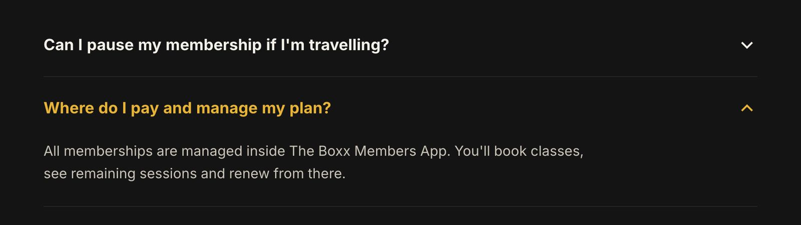

*Memberships FAQ (live): "Where do I pay and manage my plan?" Inside the members app: book classes, see remaining sessions, renew.*

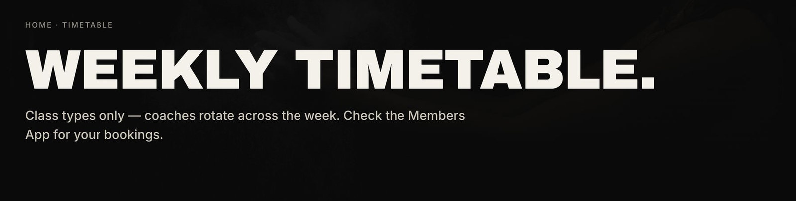

*Timetable (live): class types only; bookings happen in the app, so the website stays static, with no booking engine or payments to maintain.*

---

## 10 · Mobile

### Built for the phone.
- **Static HTML pages:** no page builder, no framework.
- One stylesheet with design tokens; dark theme; Archivo Black + Inter.
- **One vanilla JS file** runs the drawer, scroll reveals, the hero, the timetable filters and the FAQ.
- Motion switches off when the phone asks for reduced motion.
- Wide content (the timetable, the Train sub-menu) scrolls sideways instead of shrinking.

| Menu (live) | Memberships (live) | HYROX (live) |
|:---:|:---:|:---:|
| 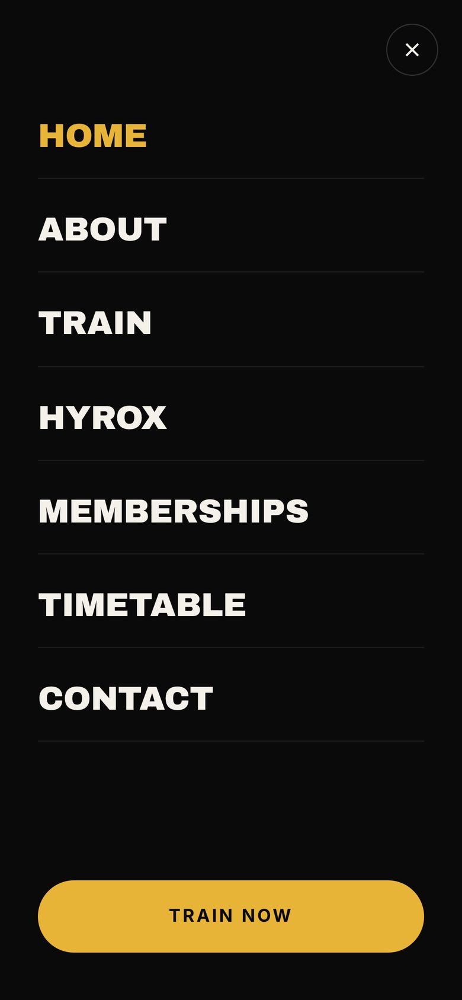 | 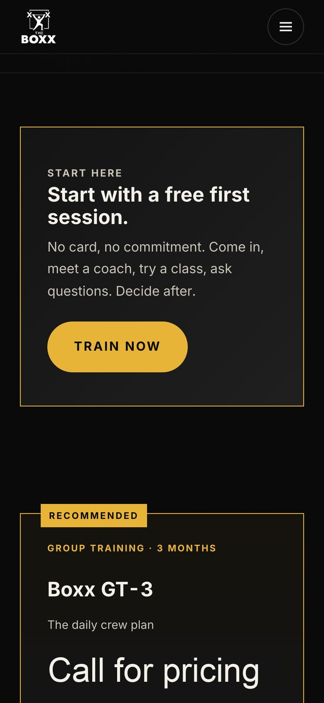 | 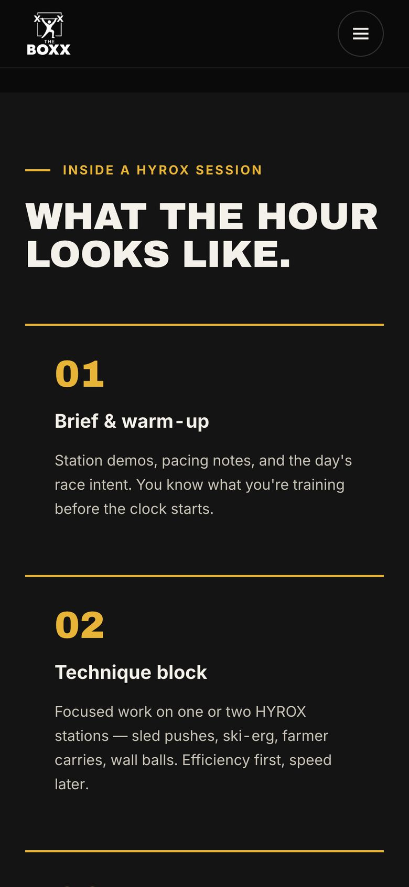 |
| A full-screen drawer with big links and "Train now" at thumb height. | "Start with a free first session" comes before any plan. | Four-column sections restack into one readable column. |

---

## 11 · Delivery

| 19 hours | 27 plans |
|---|---|
| About 19 hours from the first build file to the relaunched site. AI-assisted. | Membership plans in FitGymSoftware — chosen for the studio and set up with the vendor. |
| *April 2026* | *April 2026 · in the members app* |

---

## 12 · How it was built

### Directed, tested, relaunched.

**My role · freelance.** Designed and delivered the rebuild, AI-assisted: I gathered the requirements, made the product and design decisions, directed AI coding tools, tested every change and ran the relaunch.

I also chose the studio's membership software, FitGymSoftware, and set it up with the vendor. Two parts update without code: the Instagram feed (Behold) shows new posts, and the enquiry form's questions are edited in Google Forms.

**Stack:** HTML5 · CSS3 (design tokens, dark theme) · vanilla JavaScript · mobile-first, responsive · no framework · Archivo Black + Inter · IntersectionObserver reveal animations · FitGymSoftware · AI coding tools

**Start · April 2026 → about 19 hours → live · theboxx.in**

| 01 Requirements | 02 Design direction | 03 Build | 04 Test | 05 Relaunch |
|---|---|---|---|---|
| Formats, plans, timetable, voice | Dark, editorial, studio yellow | Pages built with AI coding tools | Every change checked on desktop and phone | Live at [theboxx.in](https://theboxx.in) |

---

## More screens: full pages from the demo build

Longer views of the same pages from the earlier demo build (placeholder brand "Pulse"; cropped to leave out coach and member photos, prices masked as "Call for pricing").

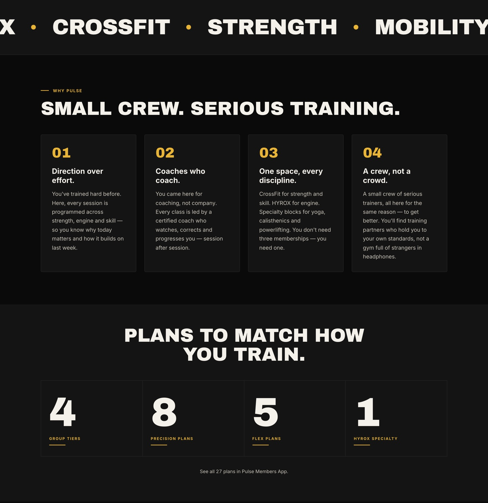

*Home (demo build): the four "why here?" cards, then the plans-at-a-glance counter and the pointer to all 27 plans.*

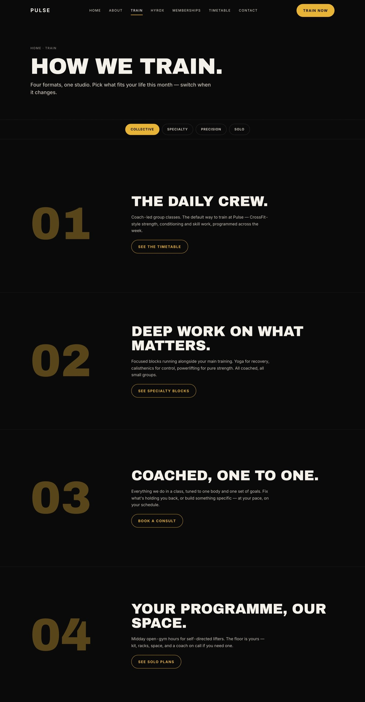

*Train (demo build): the four formats on one page, each with its own next step.*

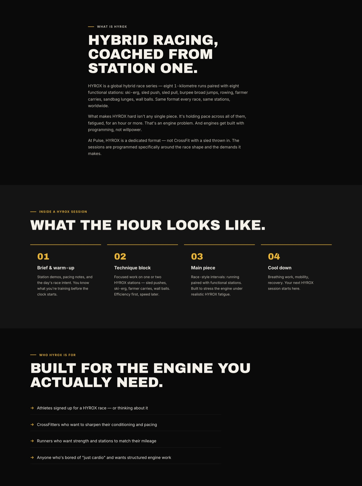

*HYROX (demo build): what HYROX is, the four-part hour and who it's for.*

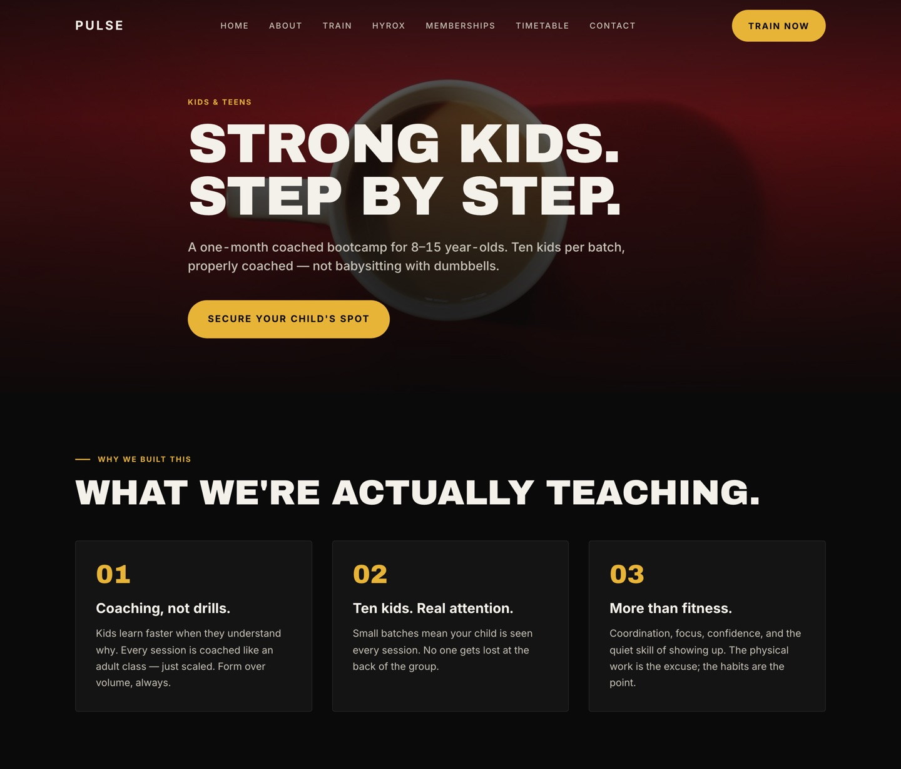

*Kids & Teens (demo build): the bootcamp hero and the "what we're actually teaching" cards.*

  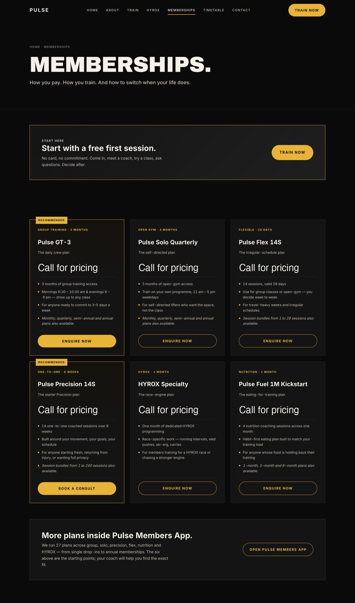 
  <em>Memberships (demo build): free first session first, then six plan cards and the pointer to all 27 plans; prices masked as "Call for pricing".</em>

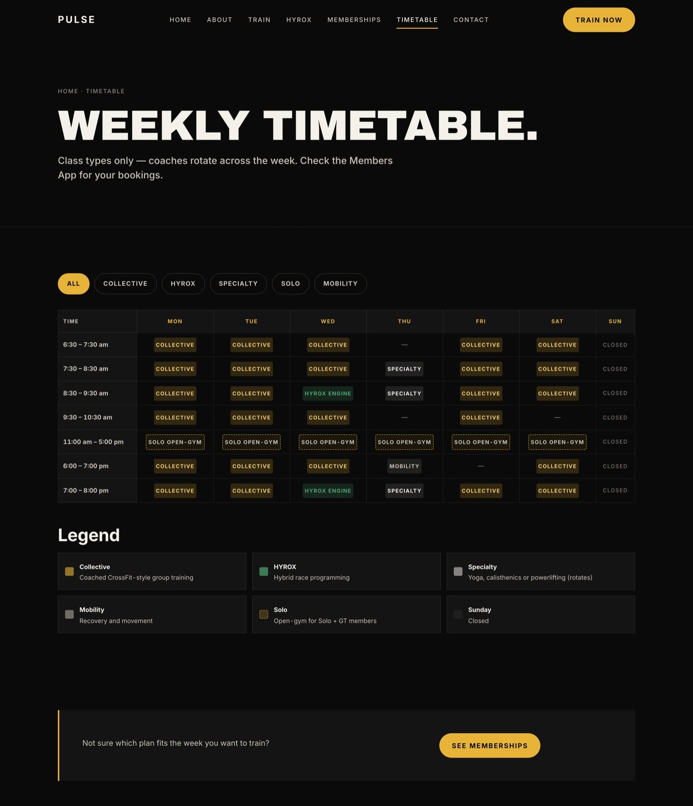

*Timetable (demo build): the whole week, the class-type filters and the colour legend.*

| Train (demo build) | HYROX (demo build) | Kids & Teens (demo build) |
|:---:|:---:|:---:|
| 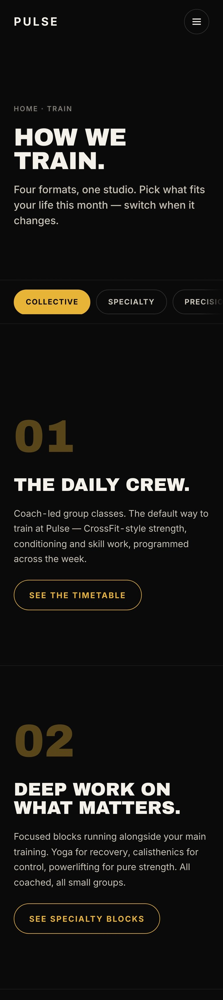 | 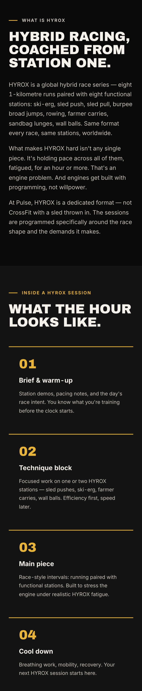 | 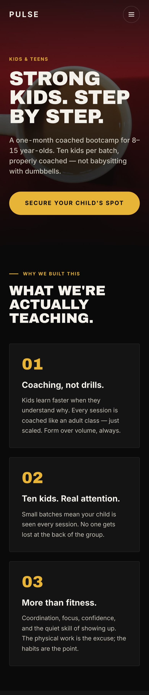 |
| The format tabs scroll sideways; each format stacks into one column. | The race explainer and the four-part hour, one column. | The bootcamp pitch and its three cards, stacked. |

| Memberships (demo build) | Timetable (demo build) |
|:---:|:---:|
| 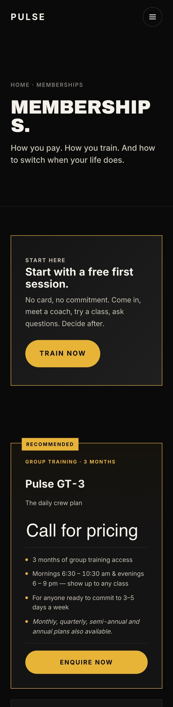 | 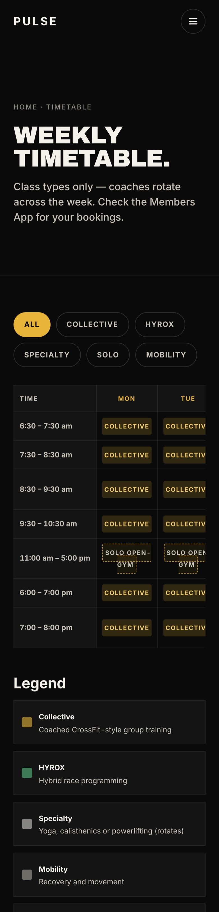 |
| Free first session before any plan; price masked as "Call for pricing". | Two rows of filter chips; the grid scrolls sideways, then the legend. |

---

## Designed & delivered by Abhishek M.
AI-assisted · freelance · April 2026

**Live site:** [theboxx.in](https://theboxx.in) · **More work:** [github.com/abBytes-sudo](https://github.com/abBytes-sudo) · Related showcases: [Real Estate Platform — public website](https://github.com/abBytes-sudo/real-estate-listings-website-showcase) · [Construction & Interior Design Firm — website](https://github.com/abBytes-sudo/interior-design-studio-website-showcase) · [Constellation — 3D business planning tool](https://github.com/abBytes-sudo/interactive-business-planner-3d)

© 2026 Abhishek Anand Masih. Write-up and screenshots shared for portfolio review; not licensed for reuse.
